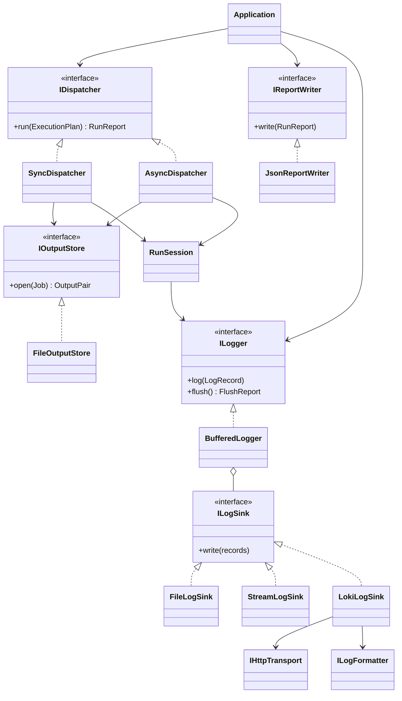

# Архитектура и обоснование по заданию

## Общая модель

`Job` и `ExecutionPlan` — объекты-значения с закрытыми полями. Их конструкторы проверяют инварианты: допустимый ID, отсутствие NUL в аргументах, уникальность ID, положительные лимиты. Получив `ExecutionPlan`, диспетчер может опираться на эти гарантии. Наличие исполняемого файла не проверяется в модели: по условию ошибка запуска отдельной программы должна стать её результатом, а остальные программы должны выполниться.

`JobResult`, `CapturedStream`, `CompletionEvent`, `RunReport` — записи результата. Они не владеют процессами и не зависят от Boost, JSON или Loki. Два диспетчера возвращают одинаковую модель. Приватный `RunSession` собирает результаты и проверяет, что задание не запущено/завершено дважды. Статус результата определяется с учётом запуска, ожидания, кода завершения и ошибок сохранения.

`AppConfig` отделяет параметры интерфейса программы (режим, путь к отчёту, параметры логов) от `ExecutionPlan` (задания, лимит, размер блока). Поэтому диспетчер не должен читать JSON или знать URL Loki.

| Требование | Компонент и решение |
|---|---|
| Путь и аргументы каждой программы | `Job`; список аргументов передаётся Boost.Process без оболочки |
| Два режима работы | `IDispatcher`, реализации `SyncDispatcher`, `AsyncDispatcher` |
| Несколько независимых процессов | Ограниченное число корутин-работников в `AsyncDispatcher` |
| Чтение stdout и stderr | Два отдельных канала `ProcessSession`; оба всегда обслуживаются |
| Большой объём данных | `IOutputCapture`: потоковая запись, один блок на канал, ограниченная память |
| Код завершения и ошибки | `JobResult`: статус, optional-код, отдельные ошибки каналов |
| Сбой одного задания не прерывает другие | Ожидаемые ошибки превращаются в результаты; очередь продолжает работу |
| Порядок уведомлений | `RunSession::exited`, отдельный `CompletionEvent` в момент обработки `async_wait` |
| Итоговый отчёт | `IReportWriter` и `JsonReportWriter`, атомарная замена файла |
| Параметры через конфиг | `IConfigLoader` и строгий `JsonConfigLoader` |
| Логирование без заметного влияния сети | `BufferedLogger`, доставка после исполнения заданий |
| Loki и другие способы записи | `ILogSink`: файловый, потоковый и Loki-приёмники |
| Воспроизводимая проверка | Дочерний режим `--fixture`, фиксированные ожидаемые байты и коды |

## Связи компонентов

`main.cpp` — место сборки зависимостей: загружает конфигурацию, выбирает конкретные компоненты и связывает их. `Application` знает только интерфейсы диспетчера, отчёта и логгера. Тест приложения заменяет все три реализации, не создавая процессы и файлы.

## Реальное выполнение

В синхронном режиме запускается одно задание, его каналы обслуживаются через блокирующий `poll` в Linux или два блокирующих читателя в Windows, затем выполняется блокирующий `wait`. Если читать stdout до EOF и только потом stderr, ребёнок может заполнить stderr и остановиться: поэтому оба канала обслуживаются уже в синхронном режиме. В Linux потоков-читателей нет. В Windows отдельный поток обслуживает каждый канал одного процесса; следующий процесс запускается после сбора обоих каналов и `wait`. Асинхронные вызовы в синхронном адаптере не используются. Файлы `src/platform/Windows*.cpp` и `Posix*.cpp` выбираются CMake; общие сценарии не зависят от ОС.

В асинхронном режиме используется один поток `io_context`. На каждое активное задание конкурентно выполняются три корутины: чтение stdout, чтение stderr, ожидание процесса. Используются `co_await`, `co_return`, `co_spawn`, `async_read_some`, `async_wait`; ожидание не занято опросом готовности. Счётчики очереди, журнал и результаты изменяются на одном потоке, поэтому не нуждаются в мьютексе.

Запись очередного блока выполняет пул из двух потоков. Корутина приостанавливается до окончания записи и не переиспользует буфер раньше; завершение возвращается на executor Asio. На канал есть максимум одна незавершённая запись. Память под блоки составляет примерно `2 × max_processes × block_size`, плюс метаданные результатов и ограниченный журнал. Пул выполняет только дисковую запись; ожидание дочерних процессов и чтение каналов остаются асинхронными операциями Asio.

Слот задания освобождается после завершения процесса и EOF обоих каналов. Это консервативно ограничивает также число открытых файлов и занятых буферов. Отдельное уведомление о завершении процесса фиксируется раньше, непосредственно после `async_wait`. Ошибка записи не отменяет чтение: остаток проблемного потока отбрасывается с сохранением диагностики, а второй поток и остальные процессы продолжают работу.

## ООП и SOLID

- **Инкапсуляция:** `Job`, `ExecutionPlan`, `RunSession`, `ProcessSession` защищают свои правила и состояние. Дескрипторы процессов, каналов и файлов освобождаются владельцами через RAII.
- **Полиморфизм:** `Application` работает с `IDispatcher`, независимо от выбранного режима. Логгер использует коллекцию `ILogSink`, не проверяя конкретный тип каждого приёмника.
- **Композиция:** диспетчер получает хранилище и логгер, приложение — диспетчер и writer. Зависимости передаются явно, глобальных сервисов нет.
- **S:** загрузчик разбирает конфигурацию; диспетчеры исполняют; модель описывает; writer сериализует; форматтер формирует строку; sink доставляет; транспорт выполняет HTTP.
- **O:** новый writer, sink или диспетчер реализует существующий контракт. Подключение меняет выбор компонентов в `main`, а модель и `Application` не меняются.
- **L:** оба диспетчера возвращают по одному результату на задание в исходном порядке; результаты доступны только после сбора вывода; ожидаемые ошибки заданий не выбрасываются наружу. Общие тесты запускаются против обоих через `IDispatcher`.
- **I:** интерфейс приёмника не содержит настройки корутин или методов загрузки конфигурации; HTTP-транспорт знает только POST JSON; хранилище выдаёт отдельные объекты захвата.
- **D:** сценарий приложения зависит от интерфейсов. Boost.Process/Asio сосредоточены в реализациях исполнения; JSON — в адаптерах ввода/отчёта/форматирования; curl — в HTTP-транспорте. Конкретный `ProcessSession` является внутренней деталью двух инфраструктурных реализаций, наружу он не выходит.

Записи результатов остаются простыми структурами: методы добавлены там, где есть поведение и инварианты. Наследование модели задания от модели процесса не требуется — конфигурация и живой системный ресурс имеют разные жизненные циклы.

## Как вносить изменения

| Изменение | Где править |
|---|---|
| Новый формат отчёта | Новая реализация `IReportWriter`, подключение в `main` |
| Новый приёмник логов | Реализация `ILogSink`, опция конфигурации, подключение в `main` |
| Другой формат логов | Реализация `ILogFormatter` |
| Другой HTTP-клиент | Реализация `IHttpTransport` |
| Хранение вывода в другом месте | Реализации `IOutputStore` / `IOutputCapture` |
| Новый способ исполнения | Реализация `IDispatcher` с тем же контрактом |
| Другой формат конфигурации | Реализация `IConfigLoader` |
| Новый параметр задания | Модель, проверка ввода, соответствующий адаптер процесса |

## Воспроизводимость и измерения

Байты потоков и коды завершения для фиксированного эталона одинаковы в обоих режимах. Порядок результатов фиксирован. Порядок уведомлений является наблюдением ОС и при близких длительностях может меняться; искусственно сортировать его нельзя по условию задания. Для наглядного эталона задержки сильно различаются, а проверка правильности сравнивает содержимое отдельно от времён и имён каталогов.

Логи двух событий на задание и четырёх событий жизненного цикла укладываются в заранее рассчитанный буфер. При невозможности сохранить запись счётчик потерь явно возвращается при `flush`. Файловая и HTTP-доставка выполняются после измерения диспетчера; полное время запуска отдельно измеряется в исследовании. При аварийном завершении до `flush` буферные логи могут быть потеряны — это осознанное свойство пакетного режима.

Реализации логирования адаптированы из уже использованных компонентов первого задания; второе задание собирается самостоятельно и не изменяет цели компоновщика.

Справочники: [Boost.Process](https://www.boost.org/doc/libs/1_83_0/doc/html/process.html), [корутины Boost.Asio](https://www.boost.org/doc/libs/1_83_0/doc/html/boost_asio/overview/composition/cpp20_coroutines.html), [Loki HTTP API](https://grafana.com/docs/loki/latest/reference/loki-http-api/).
